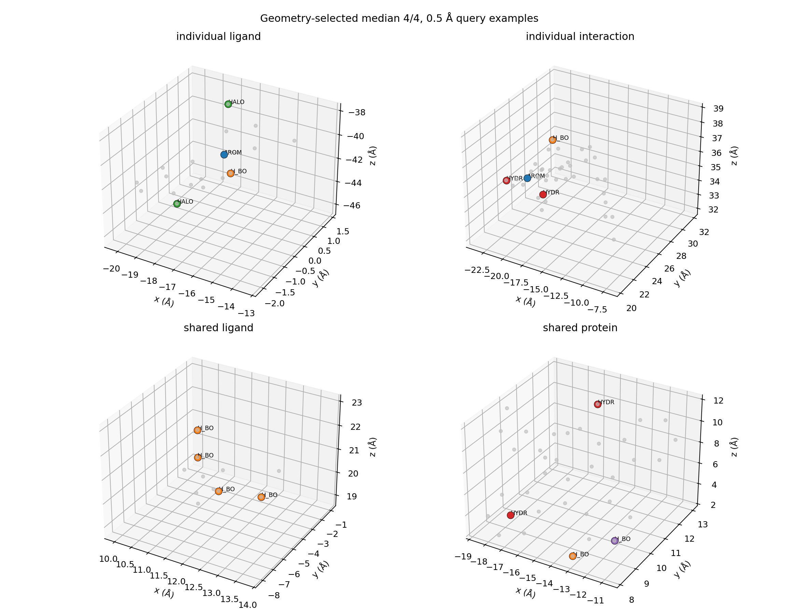

# PLINDER-22 pharmacophore allocation experiment

**Internal laboratory report · 23 November 2026**

This study asks a practical question: when we build a reusable conformer library,
which pure source or fixed Qwen/LoQI allocation should fill its candidate slots?
RDKit provides the conventional controls. The experiment
does **not** confirm that 50:50, 75:25, or any other mixture is the single best policy.
It shows which conclusions are clear, which depend on library size, and where the
two main mixtures remain almost tied.

# Start with the query hypothesis

A pharmacophore query is a **small 3D checklist**. It says that particular chemical
features—for example, an aromatic center, one donor, and two acceptors—should occur
at particular positions. A generated conformer covers the query if it places every
requested feature close enough to those positions.

Imagine that the same ligand has experimental poses A, B, and C:

- **Individual ligand:** take the feature arrangement from pose A. Example: can a
  generated conformer reproduce A's ring center, donor, and acceptors?
- **Shared ligand:** align poses A and B by the ligand and keep the features found
  in both. Example: can a conformer reproduce the ligand geometry that remains
  common across the two structures?
- **Individual interaction:** start from pose A in its protein complex and keep only
  ligand features involved in contacts. Example: if one acceptor in A does not contact
  the protein, it is left out of this query.
- **Shared protein:** align the protein sites for A and B and keep contact features
  supported in the common site frame. Example: can a conformer place its donor and
  acceptors where both aligned binding sites use them?

The first two families are ligand-only evaluations and are the primary evidence for
selecting a protein-agnostic library. The last two use protein information only to
evaluate the already generated conformers; they are useful binding-site relevance
checks, but they should not by themselves determine a protein-agnostic generation
policy.

The colored points are the feature positions in the query. The molecular and protein
geometry around them is shown only to explain where the hypotheses came from.

# What selection and coverage mean

## Selection

Selection here means **assigning library slots to a source before testing the
queries**. It does not mean examining all conformers and keeping the best matches.

- Qwen at budget 1,000 uses 1,000 cached Qwen candidates.
- LoQI at budget 1,000 uses 1,000 cached LoQI candidates.
- 50:50 uses 500 Qwen and 500 LoQI candidates.
- 75:25 uses 750 Qwen and 250 LoQI candidates.
- 25:75 was also run as an unequal-allocation sensitivity check.
- Each RDKit control uses 1,000 candidates from its own cache.

Rejected candidates still consume their assigned slots. The budget is therefore a
**cached-candidate budget**, not the number of valid conformers and not the number of
generation attempts.

## Coverage

One query is covered when at least one candidate:

1. is chemically valid and has the correct molecular identity; and
2. matches every feature required by that query within the chosen distance.

If a library covers 80% of a set of queries, an intuitive reading is that it satisfies
about 8 of every 10 3D checklists. The formal calculation first averages related
queries within their parent hypothesis, then within each molecule, and finally gives
each molecule equal weight.

The main hard task in this report is **6/6 at 0.5 Å**: all six selected features must
match, and every feature must be within half an ångström of its target position.

# Experiment setup

## Query scale

| Query family | Information used | Total queries | Hard 6/6 queries | Molecules in hard task |
| --- | --- | --- | --- | --- |
| Individual ligand | One ligand pose | 11,430 | 612 | 21 |
| Shared ligand | Two or three ligand poses | 26,388 | 601 | 19 |
| Individual interaction | One protein–ligand complex | 7,191 | 271 | 18 |
| Shared protein | Two or three aligned protein sites | 12,450 | 186 | 11 |

- The panel contained 22 ligand identities and 1,067 experimental references.
- Query construction produced 57,459 unique queries from 809 parent hypotheses.
- The primary grid tested seven feature rules, three distance tolerances, seven
  recipes, and four candidate budgets: 20, 100, 500, and 1,000.
- Additional three-pose constructions were tested for the two shared-query families.

## Candidate validity

| Source | Final valid candidates | Valid share |
| --- | --- | --- |
| Qwen | 20,063 of 22,000 | 91.20% |
| LoQI | 19,772 of 22,000 | 89.87% |
| RDKit raw | 22,000 of 22,000 | 100.00% |
| RDKit minimized | 21,999 of 22,000 | 100.00% |

The learned sources lost about 9–10% of their cache entries to the validity and
identity checks, while RDKit retained essentially all entries. Failed entries were
not replaced, so the learned methods reached their reported coverage with fewer
valid candidates inside the same nominal budget.

# Results

## Hard-task coverage at each library size

The figure keeps the four tasks separate. The top row contains the two ligand-only
tasks used for selection; the bottom row contains the protein-informed checks.

Budget 20 shows small-library behavior, and budget 1,000 shows the intended
large-library comparison. The figure shows the intermediate budgets.

### Budget 20

| Recipe | Individual ligand | Shared ligand | Individual interaction | Shared protein |
| --- | --- | --- | --- | --- |
| Qwen | 39.68% | 49.92% | 28.34% | 26.33% |
| LoQI | 49.65% | 64.52% | 45.72% | 43.53% |
| Qwen/LoQI 50:50 | 51.08% | 65.45% | 45.25% | 44.24% |
| Qwen/LoQI 75:25 | 48.55% | 62.23% | 40.81% | 40.23% |
| Qwen/LoQI 25:75 | 51.68% | 66.46% | 46.95% | 45.38% |
| RDKit raw | 36.26% | 44.19% | 24.51% | 29.32% |
| RDKit minimized | 47.51% | 55.75% | 45.47% | 44.18% |

### Budget 1,000

| Recipe | Individual ligand | Shared ligand | Individual interaction | Shared protein |
| --- | --- | --- | --- | --- |
| Qwen | 84.92% | 92.70% | 85.76% | 88.03% |
| LoQI | 79.37% | 89.85% | 79.72% | 75.82% |
| Qwen/LoQI 50:50 | 86.31% | 93.70% | 87.24% | 87.08% |
| Qwen/LoQI 75:25 | 86.57% | 93.69% | 87.37% | 88.60% |
| Qwen/LoQI 25:75 | 85.09% | 93.08% | 86.02% | 84.15% |
| RDKit raw | 61.27% | 66.71% | 46.07% | 53.64% |
| RDKit minimized | 60.63% | 68.83% | 60.91% | 55.36% |

At budget 20, LoQI and the LoQI-heavy mixtures are usually strongest. As the library
grows, Qwen gains more coverage. At budget 1,000, Qwen is above LoQI in every hard
task, and every learned recipe is clearly above the stronger RDKit control.

## Direct hard-task differences at budget 1,000

Each row below is one task under the same 6/6, 0.5 Å rule. There is **no averaging
across the four task families** in this table. Positive differences favor Qwen over
LoQI or 75:25 over 50:50.

| Hard task | Qwen − LoQI | 75:25 − 50:50 | Numerically highest learned recipe | Stronger RDKit control | Learned − RDKit |
| --- | --- | --- | --- | --- | --- |
| Individual ligand | +5.56 points | +0.26 points | Qwen/LoQI 75:25 (86.57%) | RDKit raw (61.27%) | +25.30 points |
| Shared ligand | +2.85 points | -0.01 points | Qwen/LoQI 50:50 (93.70%) | RDKit minimized (68.83%) | +24.87 points |
| Individual interaction | +6.04 points | +0.12 points | Qwen/LoQI 75:25 (87.37%) | RDKit minimized (60.91%) | +26.46 points |
| Shared protein | +12.21 points | +1.52 points | Qwen/LoQI 75:25 (88.60%) | RDKit minimized (55.36%) | +33.24 points |

This table supports three direct observations:

- The learned-versus-RDKit advantage is large in every hard task: about 25–33 points
  for the numerically highest learned recipe.
- Qwen's large-budget advantage over LoQI is task dependent: it ranges from 2.85
  points for shared ligand to 12.21 points for shared protein.
- The 50:50 and 75:25 coverage values are almost the same in the two ligand-only
  tasks. Their differences are +0.26 points for individual ligand and −0.01 points
  for shared ligand. These numbers do not establish either mixture as the structural
  winner.

## Full-grid sensitivity check

The main comparison above uses the deliberately difficult 6/6, 0.5 Å task. For
completeness, the next figure summarizes the entire primary grid. Each cell averages
the seven feature rules and three distance tolerances for one task, recipe, and
budget. This descriptive average is a check against relying on one hard setting; it
is not the basis for choosing an allocation.

The easier rules often approach complete coverage, which compresses differences.
The broad pattern remains the same: learned libraries separate from RDKit as the
budget grows, and no single Qwen/LoQI allocation dominates every task and budget.

## Qwen breadth and LoQI density

Coverage records whether a query is reached at least once. It does not say whether
one or hundreds of candidates match that query. The table below uses the 4/4,
0.5 Å, budget-1,000 setting to show both ideas. “Matching candidate share” is the
percentage of all requested cache slots that are both valid and matching.

| Task | Qwen coverage | LoQI coverage | Qwen matching candidate share | LoQI matching candidate share |
| --- | --- | --- | --- | --- |
| Individual ligand | 98.33% | 94.39% | 31.99% | 40.26% |
| Shared ligand | 99.78% | 95.74% | 39.84% | 47.51% |
| Individual interaction | 98.79% | 94.77% | 28.49% | 36.89% |
| Shared protein | 99.40% | 93.10% | 27.55% | 31.21% |

Qwen reaches more different queries at this large budget, while LoQI places a larger
share of its candidates in regions that it already reaches. In simple terms, Qwen
has greater breadth and LoQI has greater local density. That difference is a
reasonable motivation for testing mixtures, but it does not by itself prove that
one mixture ratio is best.

## Additional shared-query constructions

The primary shared queries were built from two poses with support required in both.
The complete experiment also built queries from three poses. The table below keeps
the hard 6/6, 0.5 Å, budget-1,000 setting and reports the main decision candidates.
The 25:75 sensitivity results remain in the complete data archive.

| Task | Three-pose rule | Molecules | Qwen | LoQI | 50:50 | 75:25 | Stronger RDKit control |
| --- | --- | --- | --- | --- | --- | --- | --- |
| Shared ligand | All three poses | 17 | 93.40% | 90.07% | 93.43% | 93.35% | RDKit raw (65.26%) |
| Shared ligand | At least two of three | 17 | 92.03% | 89.93% | 92.78% | 92.79% | RDKit raw (61.83%) |
| Shared protein | At least two of three | 9 | 78.15% | 78.52% | 83.63% | 82.55% | RDKit minimized (52.04%) |
| Shared protein | All three poses | 6 | 78.89% | 74.00% | 83.99% | 82.92% | RDKit raw (48.33%) |

The additional constructions preserve the large learned-versus-RDKit separation.
The shared-protein rows contain only 6–9 eligible molecules, so their small differences
between learned recipes should be treated as exploratory.

# Geometric diversity

Coverage asks whether at least one candidate passes a checklist. Diversity asks how
many distinct 3D geometries are present. Valid conformers were grouped by
symmetry-aware heavy-atom RMSD at a 0.5 Å clustering radius. More clusters mean that
the library explores more distinct shapes.

At budget 1,000:

| Recipe | Mean distinct clusters | Difference from 50:50 |
| --- | --- | --- |
| Qwen | 279.63 | +59.17 |
| LoQI | 100.68 | -119.78 |
| Qwen/LoQI 50:50 | 220.46 | +0.00 |
| Qwen/LoQI 75:25 | 256.74 | +36.28 |
| Qwen/LoQI 25:75 | 172.75 | -47.70 |
| RDKit raw | 144.61 | -75.85 |
| RDKit minimized | 102.42 | -118.04 |

Among the tested allocation recipes, pure Qwen has the most clusters. The 75:25
mixture retains 256.74 clusters on average, compared with 220.46 for 50:50 and
100.68 for LoQI. Thus, 75:25 gives up some of Qwen's breadth but preserves more of
it than 50:50.

# Simple generation-time estimate

Generation time was not measured in this cached-conformer experiment. The following
calculation uses one explicit assumption: **one cached Qwen candidate takes one
time unit, while one cached LoQI candidate takes two time units**. This represents
the laboratory expectation that Qwen is about twice as fast. Actual wall time can
change with batching, GPU memory, and parallel execution.

| Recipe | Estimated time versus 50:50 | Candidates in the same time versus 50:50 |
| --- | --- | --- |
| Qwen | 66.7% | 150.0% |
| Qwen/LoQI 75:25 | 83.3% | 120.0% |
| Qwen/LoQI 50:50 | 100.0% | 100.0% |
| Qwen/LoQI 25:75 | 116.7% | 85.7% |
| LoQI | 133.3% | 75.0% |

For 1,000 candidates, 50:50 costs 1,500 relative time units and 75:25 costs 1,250.
Under the twofold-speed assumption, 75:25 therefore uses 16.7% less generation time,
or produces 20% more candidates in the same time. This gives 75:25 a practical edge
over 50:50 **if the speed assumption holds on the production hardware**. It is not
evidence that 75:25 has better pharmacophore coverage.

# Selection interpretation

The ligand-only hard tasks are the appropriate starting point for a protein-agnostic
library decision:

- At budget 1,000, 75:25 and 50:50 differ by only +0.26 points on individual ligand
  and −0.01 points on shared ligand.
- Their hard-task coverage is therefore effectively tied at the precision useful for
  this exploratory panel.
- Diversity favors 75:25 over 50:50.
- The simple timing estimate also favors 75:25 if Qwen is truly twice as fast.
- 50:50 remains an easy-to-explain equal-source baseline.

The result is a choice between two reasonable policies, not confirmation of one
optimum. **50:50 is the simpler balanced baseline. 75:25 is the more attractive
operational candidate when diversity and the current timing assumption are included.**
A controlled timing run and a larger molecular panel would be needed before calling
either allocation the confirmed best policy.

# Conclusions

The clearest result is that learned conformer libraries outperform both RDKit controls
on the difficult pharmacophore tasks at large scale. Qwen and LoQI also show different
sampling behavior: Qwen expands to broader coverage and greater geometric diversity,
whereas LoQI supplies denser matching populations and stronger small-budget coverage.
This complementarity makes a mixture reasonable. The present experiment does not
separate 50:50 from 75:25 by hard-task coverage, but diversity and the assumed Qwen
speed give 75:25 a practical—not yet confirmed—advantage.

# Scope and data

- The study is exploratory and contains 22 selected ligand identities.
- Coverage measures agreement with the tested 3D feature arrangements. It does not
  demonstrate binding affinity, docking enrichment, or downstream model improvement.
- Protein-informed queries are after-the-fact relevance checks; the generators still
  receive ligand information only.
- The runtime result is a calculation under one speed assumption, not a measured
  hardware-matched benchmark.
- Compact paper archive: ../../results-data/cdpkit-pharmacophore-mixture/
- Complete analysis tables: /mnt/weka/mbedrosian/code/casf-benchmark/data/results/cdpkit_plinder22_exploration_v1/tables
- Complete coverage grid SHA-256: ab06b59f86ab1993330b30638f12c5ba90fdee62f9f365a3374f99102814ccc7
- Rebuild the report and figures by running python build_report.py in this directory.
