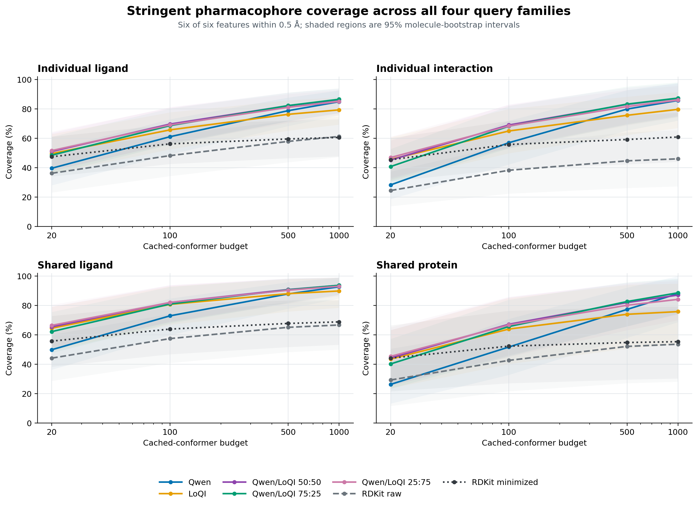
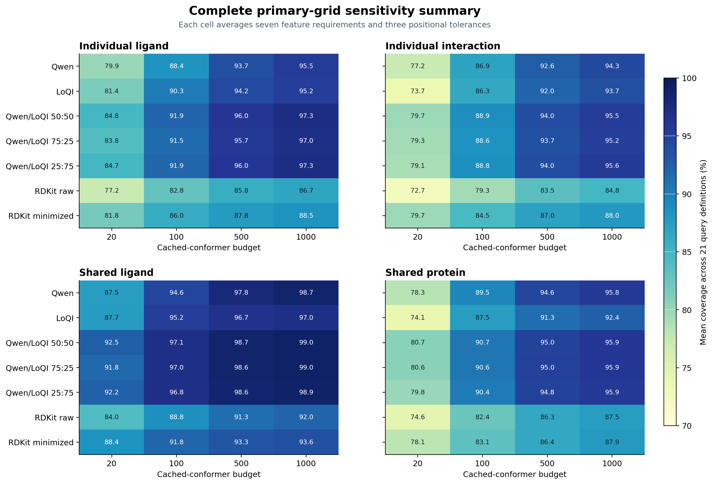
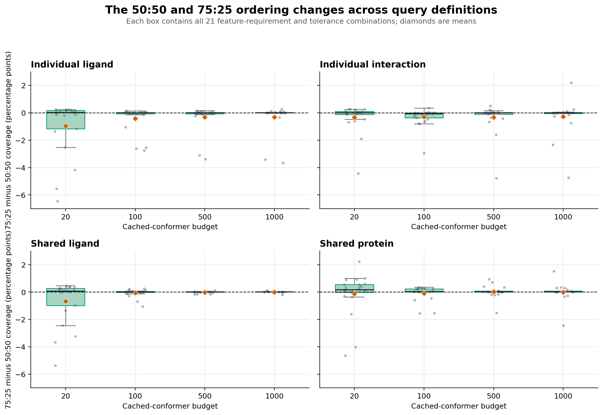
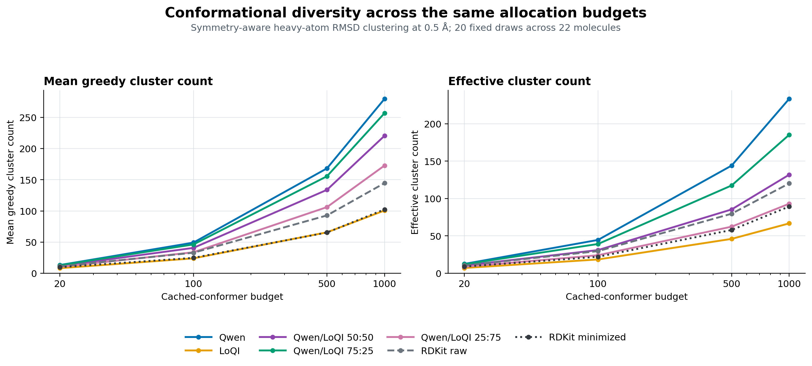
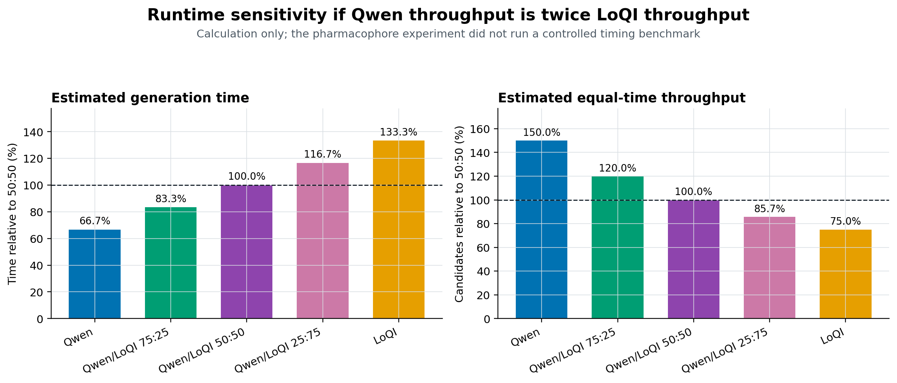

# PLINDER-22 pharmacophore allocation experiment

**Internal laboratory report · 23 November 2026**

This experiment compared fixed conformer-library recipes built from Qwen, LoQI,
three Qwen/LoQI mixtures, and RDKit. The main question was whether a generated library
contains at least one conformer that satisfies pharmacophore arrangements observed
in experimental structures. The generators received the ligand only; protein
information was used only afterward to construct two of the evaluation-query families.

The broad result is straightforward. LoQI is strong at small library sizes, Qwen
improves more as the library grows, and the learned generators separate clearly
from RDKit in the stringent large-library comparison. At 1,000 conformers, 50:50
and 75:25 have almost identical coverage. Qwen and 75:25 retain more geometric
diversity than 50:50. If Qwen is assumed to generate accepted conformers twice as
fast as LoQI, 75:25 also has an estimated 16.7% generation-time advantage over
50:50. This timing result is a sensitivity calculation, not a controlled benchmark.

# Experiment design

## How the four query groups were constructed

- **Individual ligand:** Features were read from one experimental ligand pose. No
  protein information was used. The query asks whether a generated conformer can
  reproduce that pose-specific ligand feature arrangement.

- **Individual interaction:** One experimental protein-ligand complex was used.
  Only ligand features involved in the native interaction pattern were retained.
  The query asks whether a ligand-only generated conformer can reproduce those
  protein-selected ligand features.

- **Shared ligand:** Several experimental poses of the same ligand were aligned by
  their ligand features. Features supported across the construction poses were
  retained. A separate PDB entry was held out from construction. The query asks
  whether the library covers a ligand feature arrangement shared across structures.

- **Shared protein:** Binding pockets were aligned using protein C-alpha atoms, and
  interaction features were transferred into the common protein-site frame. They
  were not realigned afterward by ligand features. A separate PDB entry was held
  out. The query asks whether the library covers an interaction arrangement shared
  in the aligned binding site.

The colored points are pharmacophore features. Gray points show the surrounding
reference geometry. These are examples for explanation, not performance results.

## Query and panel size

| Query family | All queries | Parent hypotheses | Molecules with queries | Strict 6/6 queries | Strict molecules |
| --- | --- | --- | --- | --- | --- |
| Individual ligand | 11,430 | 132 | 22 | 612 | 21 |
| Individual interaction | 7,191 | 132 | 22 | 271 | 18 |
| Shared ligand | 26,388 | 318 | 20 | 601 | 19 |
| Shared protein | 12,450 | 227 | 18 | 186 | 11 |

- The panel contained **22 ligand identities and 1,067 experimental references**.
- The full query construction produced **57,459 unique queries from 809 parent hypotheses**.
- The primary allocation grid contained **2,352 coverage cells**: four families,
  seven feature requirements, three tolerances, seven recipes, and four budgets.
- Secondary shared-query constructions added another **2,352 cells**, producing
  **4,704 coverage cells** in the complete analysis.
- Feature requirements were 3/3, 4/4, 5/5, 6/6, 4/5, 5/6, and the complete available
  hypothesis. Position tolerances were 0.5, 0.75, and 1.0 Å.

## How candidate libraries were tested

- Each source supplied a cache of 1,000 conformers per molecule. No new conformers
  were generated for this analysis.
- Candidate budgets were 20, 100, 500, and 1,000 cached conformers. Mixed libraries
  used exact source quotas. For example, 75:25 at budget 1,000 used 750 Qwen and
  250 LoQI cache entries.
- A query was covered when at least one sampled conformer passed the native CDPKit
  match, PoseBusters, stored-graph identity, and coordinate-derived identity checks.
- Rejected entries still consumed the candidate budget and were not replaced.
- Coverage was averaged within each parent hypothesis, then within each molecule,
  and finally across molecules with equal molecule weight.
- Intervals used 5,000 molecule-level bootstrap resamples. Queries from one molecule
  were therefore not treated as independent observations.
- Query features used positions only. Feature directions and exclusion volumes were
  disabled, and candidate conformers were allowed to contain additional features.

**Coverage in simple terms:** the expected percentage of pharmacophore queries for
which a library of the requested size contains at least one valid matching conformer.

## Cache validity before coverage

| Source | Supplied | PoseBusters pass | Identity pass | Final valid | Valid yield |
| --- | --- | --- | --- | --- | --- |
| Qwen | 22,000 | 20,347 | 21,275 | 20,063 | 91.20% |
| LoQI | 22,000 | 19,948 | 21,479 | 19,772 | 89.87% |
| RDKit raw | 22,000 | 22,000 | 22,000 | 22,000 | 100.00% |
| RDKit minimized | 22,000 | 21,999 | 22,000 | 21,999 | 100.00% |

The learned sources lost about 9–10% of their supplied entries to the validity and
identity gates. RDKit retained essentially every entry. Since rejected entries were
not replaced, the learned methods achieved their reported coverage with smaller
effective valid pools.

# Coverage results

## Stringent comparison used for the main interpretation

The following comparison requires all six selected features to match within 0.5 Å.
It is deliberately difficult and avoids the strong saturation seen for easier or
looser queries. The tables report means; the figure also shows the molecule-bootstrap
intervals.

### Individual ligand

| Recipe | Budget 20 | Budget 100 | Budget 500 | Budget 1,000 |
| --- | --- | --- | --- | --- |
| Qwen | 39.68% | 61.12% | 78.83% | 84.92% |
| LoQI | 49.65% | 65.76% | 76.34% | 79.37% |
| Qwen/LoQI 50:50 | 51.08% | 69.72% | 82.21% | 86.31% |
| Qwen/LoQI 75:25 | 48.55% | 68.68% | 82.30% | 86.57% |
| Qwen/LoQI 25:75 | 51.68% | 69.14% | 81.10% | 85.09% |
| RDKit raw | 36.26% | 48.25% | 57.93% | 61.27% |
| RDKit minimized | 47.51% | 56.24% | 59.58% | 60.63% |

### Individual interaction

| Recipe | Budget 20 | Budget 100 | Budget 500 | Budget 1,000 |
| --- | --- | --- | --- | --- |
| Qwen | 28.34% | 57.02% | 79.91% | 85.76% |
| LoQI | 45.72% | 65.00% | 75.68% | 79.72% |
| Qwen/LoQI 50:50 | 45.25% | 69.07% | 83.06% | 87.24% |
| Qwen/LoQI 75:25 | 40.81% | 68.28% | 83.28% | 87.37% |
| Qwen/LoQI 25:75 | 46.95% | 68.39% | 81.61% | 86.02% |
| RDKit raw | 24.51% | 38.30% | 44.71% | 46.07% |
| RDKit minimized | 45.47% | 55.83% | 59.22% | 60.91% |

### Shared ligand

| Recipe | Budget 20 | Budget 100 | Budget 500 | Budget 1,000 |
| --- | --- | --- | --- | --- |
| Qwen | 49.92% | 72.95% | 87.87% | 92.70% |
| LoQI | 64.52% | 80.73% | 88.03% | 89.85% |
| Qwen/LoQI 50:50 | 65.45% | 82.03% | 90.83% | 93.70% |
| Qwen/LoQI 75:25 | 62.23% | 80.99% | 90.66% | 93.69% |
| Qwen/LoQI 25:75 | 66.46% | 82.03% | 90.37% | 93.08% |
| RDKit raw | 44.19% | 57.47% | 65.14% | 66.71% |
| RDKit minimized | 55.75% | 63.94% | 67.78% | 68.83% |

### Shared protein

| Recipe | Budget 20 | Budget 100 | Budget 500 | Budget 1,000 |
| --- | --- | --- | --- | --- |
| Qwen | 26.33% | 51.73% | 77.31% | 88.03% |
| LoQI | 43.53% | 63.96% | 74.00% | 75.82% |
| Qwen/LoQI 50:50 | 44.24% | 67.21% | 81.96% | 87.08% |
| Qwen/LoQI 75:25 | 40.23% | 65.65% | 82.67% | 88.60% |
| Qwen/LoQI 25:75 | 45.38% | 66.73% | 80.13% | 84.15% |
| RDKit raw | 29.32% | 42.65% | 52.15% | 53.64% |
| RDKit minimized | 44.18% | 52.34% | 54.80% | 55.36% |

The budget pattern is consistent across the four families:

- LoQI is stronger than Qwen at budget 20.
- Qwen gains more from increasing the library and is above LoQI at budget 1,000.
- At budget 1,000, Qwen exceeds the stronger RDKit control by 23.65–32.67 percentage
  points across the four families. LoQI also exceeds the stronger RDKit control by
  18.10–21.02 points.
- The 50:50 and 75:25 mixtures are nearly tied at budget 1,000. The largest difference
  between them is 1.52 points in the shared-protein task; all four paired intervals
  include zero.
- The protein-informed families support the learned-versus-RDKit separation, but the
  ligand-only families remain the direct evidence for a reusable protein-agnostic library.

## Complete primary-grid summary

The stringent tables above are one predeclared slice, not an average over the full
experiment. The next figure averages all seven feature requirements and all three
tolerances within each family, recipe, and budget. This descriptive average is included
to show the complete pattern; it is not used as a separate optimization score.

| Recipe | Primary-grid cells | Mean coverage | Mean rank |
| --- | --- | --- | --- |
| Qwen | 336 | 90.33% | 3.21 |
| LoQI | 336 | 89.29% | 5.66 |
| Qwen/LoQI 50:50 | 336 | 92.35% | 2.34 |
| Qwen/LoQI 75:25 | 336 | 92.09% | 2.31 |
| Qwen/LoQI 25:75 | 336 | 92.17% | 3.21 |
| RDKit raw | 336 | 83.73% | 6.14 |
| RDKit minimized | 336 | 86.62% | 5.14 |

Easy and loose queries often approach 100% coverage, so the full-grid means compress
the differences. Even in this saturated summary, the Qwen-heavy mixtures occupy the
top average ranks, while RDKit raw is lowest overall.

The paired table below uses every primary-grid scenario rather than selected cells.
Intervals are exploratory and are not adjusted for the number of grid comparisons.

| Comparator | Cells | Qwen higher | Equal | Comparator higher | Interval favors Qwen | Interval includes zero | Interval favors comparator |
| --- | --- | --- | --- | --- | --- | --- | --- |
| LoQI | 336 | 279 | 6 | 51 | 81 | 243 | 12 |
| RDKit raw | 336 | 302 | 26 | 8 | 210 | 126 | 0 |
| RDKit minimized | 336 | 260 | 35 | 41 | 112 | 219 | 5 |

Qwen is numerically above LoQI in most cells, but most Qwen-LoQI intervals include
zero. Separation from RDKit raw is more consistent. This is why the experiment is
better described as a budget- and task-dependent Qwen-LoQI profile than as a universal
winner-loser result.

## Qwen breadth and LoQI density

Coverage gives the same success score to a query with one matching conformer and a
query with hundreds of matching conformers. The table below uses the 4/4, 0.5 Å,
budget-1,000 setting to compare those two views. The valid-hit fraction is the fraction
of all requested cache slots that are valid matches, averaged with the same molecule
weighting as coverage.

| Family | Qwen coverage | LoQI coverage | Qwen valid-hit fraction | LoQI valid-hit fraction |
| --- | --- | --- | --- | --- |
| Individual ligand | 98.33% | 94.39% | 31.99% | 40.26% |
| Individual interaction | 98.79% | 94.77% | 28.49% | 36.89% |
| Shared ligand | 99.78% | 95.74% | 39.84% | 47.51% |
| Shared protein | 99.40% | 93.10% | 27.55% | 31.21% |

Qwen reaches more distinct queries, while LoQI supplies a larger fraction of matching
conformers for the queries it reaches. This breadth-versus-density difference explains
why LoQI can be efficient at small budgets even though Qwen has greater large-budget
coverage and geometric diversity.

## Complete 50:50 versus 75:25 sensitivity

Each box contains all 21 combinations of feature requirement and positional tolerance.
Positive values favor 75:25; negative values favor 50:50. The distributions cross zero
in every family. Across these definitions, the mean difference is smaller than one
percentage point in all 16 family-budget groups. The allocation ordering is therefore
sensitive to the query definition and is not a reliable coverage distinction.

## Secondary shared-query constructions

The primary shared queries used two construction poses with support in both poses.
The complete experiment also tested three construction poses with either support in
all three or support in at least two thirds. The table shows the stringent 6/6,
0.5 Å endpoint at budget 1,000.

| Family | Construction | N | Qwen | LoQI | Qwen/LoQI 50:50 | Qwen/LoQI 75:25 | Qwen/LoQI 25:75 | RDKit raw | RDKit minimized |
| --- | --- | --- | --- | --- | --- | --- | --- | --- | --- |
| Shared ligand | 2 poses, all poses | 19 | 92.70% | 89.85% | 93.70% | 93.69% | 93.08% | 66.71% | 68.83% |
| Shared protein | 2 poses, all poses | 11 | 88.03% | 75.82% | 87.08% | 88.60% | 84.15% | 53.64% | 55.36% |
| Shared ligand | 3 poses, all poses | 17 | 93.40% | 90.07% | 93.43% | 93.35% | 93.33% | 65.26% | 63.92% |
| Shared ligand | 3 poses, at least two thirds | 17 | 92.03% | 89.93% | 92.78% | 92.79% | 92.50% | 61.83% | 60.65% |
| Shared protein | 3 poses, at least two thirds | 9 | 78.15% | 78.52% | 83.63% | 82.55% | 83.14% | 51.30% | 52.04% |
| Shared protein | 3 poses, all poses | 6 | 78.89% | 74.00% | 83.99% | 82.92% | 83.08% | 48.33% | 45.56% |

The Qwen-heavy recipes remain strong in the secondary constructions. The shared-protein
rows have only 6–11 eligible molecules, so small differences should not be treated as
stable allocation rankings.

# Geometric diversity

Coverage asks whether at least one conformer matches. Diversity asks how many distinct
geometries the library contains. Valid conformers were clustered by symmetry-aware
heavy-atom RMSD. The analysis used 20 fixed draws per allocation and budget across all
22 molecules.

At budget 1,000 and a 0.5 Å clustering radius:

| Recipe | Mean clusters | Effective clusters | Largest cluster fraction | Valid yield |
| --- | --- | --- | --- | --- |
| Qwen | 279.63 | 233.19 | 9.5% | 91.20% |
| LoQI | 100.68 | 66.72 | 31.1% | 89.87% |
| Qwen/LoQI 50:50 | 220.46 | 131.76 | 18.5% | 90.53% |
| Qwen/LoQI 75:25 | 256.74 | 185.09 | 13.2% | 90.87% |
| Qwen/LoQI 25:75 | 172.75 | 92.97 | 23.8% | 90.22% |
| RDKit raw | 144.61 | 120.13 | 14.3% | 100.00% |
| RDKit minimized | 102.42 | 89.27 | 20.1% | 100.00% |

- Pure Qwen has the highest diversity at every budget among these allocation recipes.
- Increasing the LoQI fraction progressively reduces the number of distinct clusters.
- At budget 1,000, 75:25 has 256.74 mean clusters, compared with 220.46 for 50:50.
  This is a 16.5% increase over 50:50.
- RDKit raw is more diverse than LoQI and RDKit minimized, but its pharmacophore
  coverage is substantially lower at the stringent large-library endpoint.
- Effective cluster counts give the same overall ordering and show that repeated
  occupancy within common clusters is strongest for LoQI-heavy libraries.

# Generation-time sensitivity

Generation time was not measured by this cached-conformer experiment. The following
calculation uses the laboratory assumption that **Qwen generates accepted conformers
at twice the LoQI rate**. One Qwen conformer is assigned one time unit and one LoQI
conformer two time units. The calculation represents accumulated generation work under
comparable conditions; exact elapsed wall time can differ with batching, memory, and
parallel execution.

| Recipe | Qwen share | LoQI share | Relative cost, Qwen = 1 | Time versus 50:50 | Equal-time throughput versus 50:50 |
| --- | --- | --- | --- | --- | --- |
| Qwen | 100% | 0% | 1.00 | 66.7% | 150.0% |
| Qwen/LoQI 75:25 | 75% | 25% | 1.25 | 83.3% | 120.0% |
| Qwen/LoQI 50:50 | 50% | 50% | 1.50 | 100.0% | 100.0% |
| Qwen/LoQI 25:75 | 25% | 75% | 1.75 | 116.7% | 85.7% |
| LoQI | 0% | 100% | 2.00 | 133.3% | 75.0% |

Under this assumption, a 1,000-conformer 75:25 library costs 1,250 relative time units,
whereas 50:50 costs 1,500. The 75:25 recipe therefore uses **16.7% less accumulated
generation time** or produces **20% more candidates in the same generation time**.
RDKit is excluded from this estimate because its CPU implementation and cost model are
not comparable to the Qwen-LoQI assumption.

# Combined interpretation for internal discussion

1. **The strongest result is learned versus RDKit at scale.** Qwen, LoQI, and their
   mixtures cover substantially more stringent queries than RDKit at budget 1,000,
   despite the learned pools having lower valid yield.

2. **Qwen and LoQI contribute different sampling profiles.** LoQI is efficient at
   small budgets and concentrates more samples in covered regions. Qwen expands to
   broader pharmacophore and geometric coverage as the budget increases.

3. **Coverage alone does not distinguish 50:50 from 75:25 at the production budget.**
   Their budget-1,000 ligand-only means differ by 0.26 and 0.01 percentage points,
   and both paired intervals include zero.

4. **Diversity favors the Qwen-heavy allocation.** The 75:25 recipe retains about
   36 more mean clusters per molecule than 50:50 at budget 1,000.

5. **The twofold Qwen-speed assumption also favors 75:25.** It gives an estimated
   16.7% time saving relative to 50:50. This direction is clear, but the magnitude
   should remain labeled as an estimate until both generators are timed under one
   production protocol.

6. **Practical internal recommendation:** if the twofold speed difference is confirmed
   on the intended production hardware, 75:25 is the stronger operational choice for
   a 1,000-conformer release. It has indistinguishable coverage, higher diversity, and
   lower estimated generation cost. A 50:50 library remains a simple equal-source
   baseline, but the present evidence does not make it the best-performing production
   allocation.

# Scope and limitations

- The study contains 22 selected ligand identities and is exploratory.
- Coverage means proximity to the tested pharmacophore arrangements. It does not
  demonstrate binding affinity, docking enrichment, or downstream model improvement.
- Protein-informed queries evaluate binding-site relevance after ligand-only generation;
  they do not make the generators protein-conditioned.
- The same molecule contributes many related queries. Molecules, not queries, are the
  uncertainty unit.
- Easy queries and larger tolerances saturate. The stringent 6/6, 0.5 Å condition is
  more discriminating but has fewer eligible molecules.
- The runtime section is an explicit sensitivity calculation. It is not a measured
  hardware-matched benchmark.

# Data and reproduction

- Compact paper archive: `../../results-data/cdpkit-pharmacophore-mixture/`
- Complete analysis tables: `/mnt/weka/mbedrosian/code/casf-benchmark/data/results/cdpkit_plinder22_exploration_v1/tables`
- Complete coverage grid SHA-256: `ab06b59f86ab1993330b30638f12c5ba90fdee62f9f365a3374f99102814ccc7`
- Paired-difference grid SHA-256: `f16a0521eb012b5a92f4b2a8a34bc42f7d6349887b402ca531cfc964ef38746f`
- Rebuild this report and all figures with `python build_report.py` from this directory.
